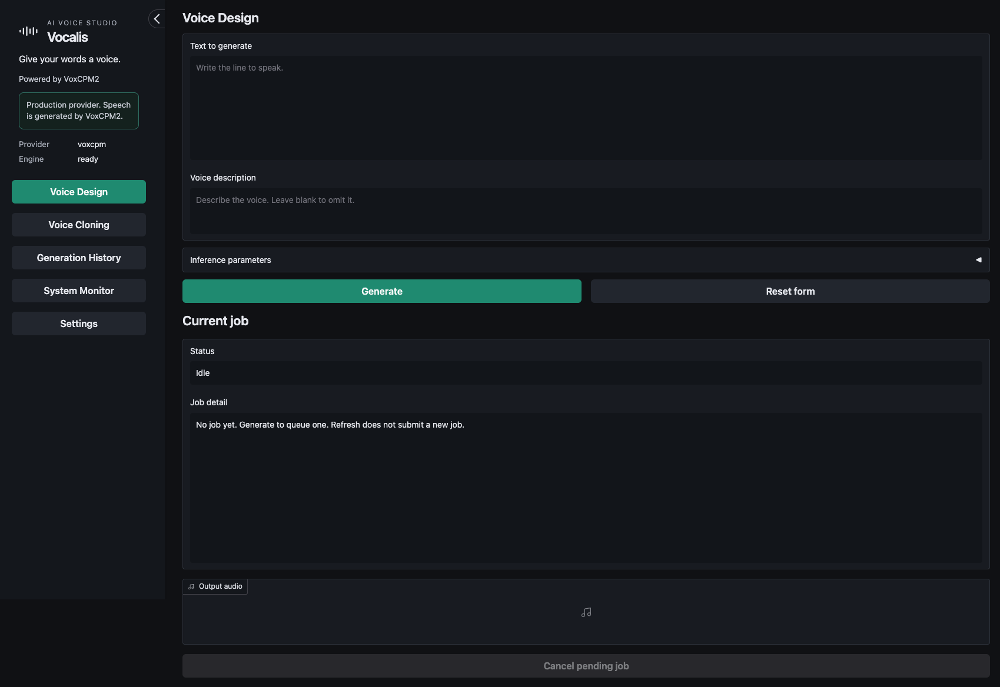
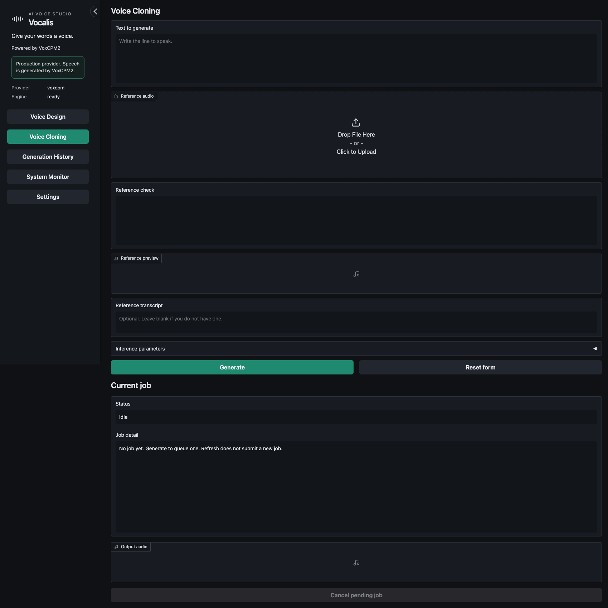
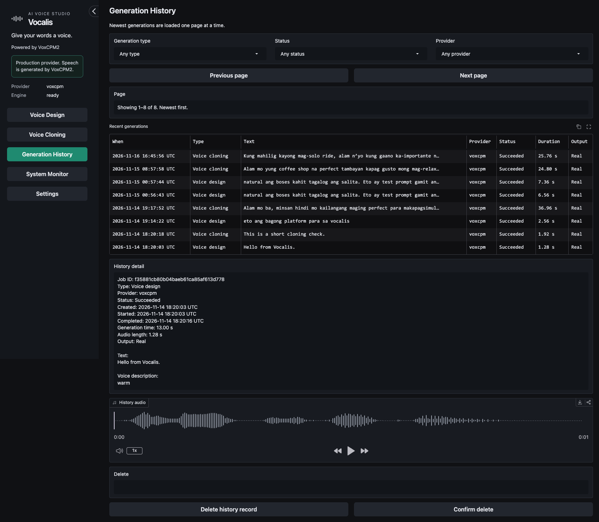

# Installing Vocalis

Vocalis runs as one local process and opens a studio in your browser. The default install uses a mock speech engine. You can try Voice Design, Voice Cloning, history, and the system monitor without downloading VoxCPM2 or PyTorch.

Real speech is a separate, optional step. It needs the `voxcpm` package, PyTorch, and a local copy of the VoxCPM2 weights.

## Requirements

- Python 3.11 or 3.12
- Git
- A machine that can run a local web server on `127.0.0.1`

The application code targets Python 3.11 and 3.12. Use one of those interpreters to create the virtual environment, even if `python3` on your system is newer.

Mock mode needs little disk space. The optional VoxCPM2 weights are several gigabytes, and CPU inference needs several more gigabytes of RAM. A machine with 16 GB of memory is a practical starting point for the real engine.

## Install

Clone this repository and change into its directory:

```bash
git clone <repository-url>
cd Vocalis
```

Use the URL from the GitHub page. The directory name matches the repository name.

Create and activate a virtual environment with Python 3.11 or 3.12.

macOS and Linux:

```bash
python3.12 -m venv .venv
source .venv/bin/activate
```

Windows (PowerShell):

```powershell
py -3.12 -m venv .venv
.venv\Scripts\Activate.ps1
```

If `python3.12` or `py -3.12` is not the command on your system, substitute the Python 3.11 or 3.12 command you installed. Then confirm the environment:

```bash
python -c "import sys; print(sys.version)"
```

The printed version should start with `3.11` or `3.12`.

Install the application:

```bash
python -m pip install --upgrade pip
python -m pip install -r requirements.txt
```

`requirements.txt` installs the studio and its runtime libraries. It does not install VoxCPM2 or PyTorch.

To run the test suite as well:

```bash
python -m pip install -r requirements-dev.txt
```

## Configure

The application starts with its built-in defaults when `.env` is absent. Copy the example if you want a file to edit:

```bash
cp .env.example .env
```

On Windows, copy the file with Explorer or `copy .env.example .env`.

Leave these defaults in place for a first run:

```text
APP_ENV=development
MODEL_PROVIDER=mock
APP_HOST=127.0.0.1
APP_PORT=7860
GRADIO_SHARE=false
```

`.env` is gitignored. Do not commit it.

Development mode accepts only a loopback `APP_HOST`: `127.0.0.1`, `localhost`, or `::1`. `GRADIO_SHARE` must stay `false`. Vocalis does not turn on Gradio's public sharing tunnel.

## Start

From the repository root, with the virtual environment active:

```bash
python app.py --check
python app.py
```

`--check` validates the configuration, creates the runtime directories, applies the database migrations, loads the selected engine, and exits. When it finishes without an error, start the studio with `python app.py`.

Open [http://127.0.0.1:7860](http://127.0.0.1:7860).

The studio has Voice Design, Voice Cloning, and Generation History. These screenshots show the VoxCPM2 provider. Mock mode uses the same pages and marks its audio as simulated.







The first start creates:

```text
data/history.db
output/design/
output/clone/
uploads/references/
logs/vocalis.log
```

Those directories hold your local history, audio, and logs. They are not part of the Git repository.

Stop the studio with Ctrl+C in the terminal that started it. If a generation is already running, the process waits for that job to finish before it exits.

## What mock mode does

`MODEL_PROVIDER=mock` does not import `voxcpm`, `torch`, or `torchaudio`. Voice Design and Voice Cloning still go through the queue and write a WAV file, but the audio is a tone labeled as simulated. It is not synthesized speech and it does not clone the uploaded voice.

Voice Cloning accepts WAV, FLAC, and MP3. The file contents must match the extension. Files larger than `MAX_UPLOAD_BYTES` (20 MiB by default) are rejected. An accepted reference is copied into `uploads/references` under a new name. The original file is left unchanged.

One generation runs at a time. `MAX_QUEUE_SIZE` is how many jobs may wait behind it (default 3).

## Run the tests

With the virtual environment active and `requirements-dev.txt` installed:

```bash
python -m pytest
python app.py --check
```

The tests use temporary directories. They do not download a model.

## Optional: real VoxCPM2 speech

Skip this section if mock mode is enough.

Install `voxcpm==2.0.3` and a matching PyTorch build into the same virtual environment, using the install instructions from the VoxCPM2 project for your platform. Vocalis does not pin those packages in `requirements.txt`. `requirements-prod.txt` is only the small application set for a machine that already has `voxcpm` and PyTorch. It is not a complete install file.

Download the VoxCPM2 weights yourself and set `VOXCPM_MODEL_PATH` to the directory that contains the model files, including `config.json`. If the weights came from a Hugging Face cache, use the snapshot directory inside that cache. The cache root is not a model directory.

Vocalis loads that directory with `local_files_only=True`. It does not download missing weights. The loader uses CPU, does not load the denoiser, and does not run the package's warmup generation.

In `.env`:

```text
MODEL_PROVIDER=voxcpm
VOXCPM_MODEL_PATH=/absolute/path/to/the/model/directory
```

A relative `VOXCPM_MODEL_PATH` must stay inside the repository. An absolute path may point anywhere on the machine.

`APP_ENV=production` also requires `MODEL_PROVIDER=voxcpm` and that model directory. You can use `MODEL_PROVIDER=voxcpm` while `APP_ENV` is still `development`. Development mode still binds to loopback only.

Keep the model process offline if you want a download to fail instead of starting:

```text
HF_HUB_OFFLINE=1
TRANSFORMERS_OFFLINE=1
HF_HUB_DISABLE_TELEMETRY=1
```

The real engine has no seed argument and no way to cancel a generation that has already started. A running job finishes or fails on its own.

`deploy/vocalis.env.example` and `deploy/vocalis.service` are examples for running the app as a loopback service. Edit the paths and the user before using them. They are not required to start the studio from a terminal.

## Settings

| Setting | Default | Purpose |
| --- | --- | --- |
| `APP_ENV` | `development` | `development` or `production` |
| `MODEL_PROVIDER` | `mock` | `mock` or `voxcpm` |
| `VOXCPM_MODEL_PATH` | empty | Model directory, required for `voxcpm` |
| `APP_HOST` | `127.0.0.1` | Bind address |
| `APP_PORT` | `7860` | Bind port |
| `VOCALIS_DATA_DIR` | `./data` | Database parent and other local data |
| `VOCALIS_OUTPUT_DIR` | `./output` | Generated audio |
| `VOCALIS_UPLOAD_DIR` | `./uploads` | Reference copies |
| `VOCALIS_LOG_DIR` | `./logs` | Rotating log |
| `VOCALIS_DATABASE_PATH` | `./data/history.db` | SQLite history file |
| `MAX_QUEUE_SIZE` | `3` | Jobs allowed to wait. Maximum 20 |
| `MAX_CONCURRENT_GENERATIONS` | `1` | Must stay 1 |
| `MAX_UPLOAD_BYTES` | `20971520` | Largest reference file. Maximum 100 MiB |
| `GRADIO_SHARE` | `false` | Must stay `false` |

Relative paths are resolved from the repository root and must stay inside it. Absolute paths are allowed. Process environment variables override `.env`.

## Troubleshooting

- The version check shows a different Python. Deactivate the current environment, remove `.venv`, and create it again with Python 3.11 or 3.12.
- `Address already in use`. Another program is using port 7860. Set a different `APP_PORT` in `.env` and start again.
- `Configuration error`. The message names the setting. Fix that value in `.env` or in the process environment.
- The finished job says it is simulated. `MODEL_PROVIDER=mock` is selected. That is the expected default.
- A submission says the queue is full. Wait for a queued job to start, or raise `MAX_QUEUE_SIZE`. The running job still uses the one worker.
- A reference upload is rejected. The message names an empty file, the size limit, an unsupported extension, or contents that are not a valid WAV, FLAC, or MP3.
- `Engine error` on startup. `MODEL_PROVIDER=voxcpm` is selected and the `voxcpm` package is missing, or `VOXCPM_MODEL_PATH` does not point at a model directory. Use `mock`, or install the package and set the path.
- `Database error` on startup. The message names the migration that failed. That migration is not left half-applied.
