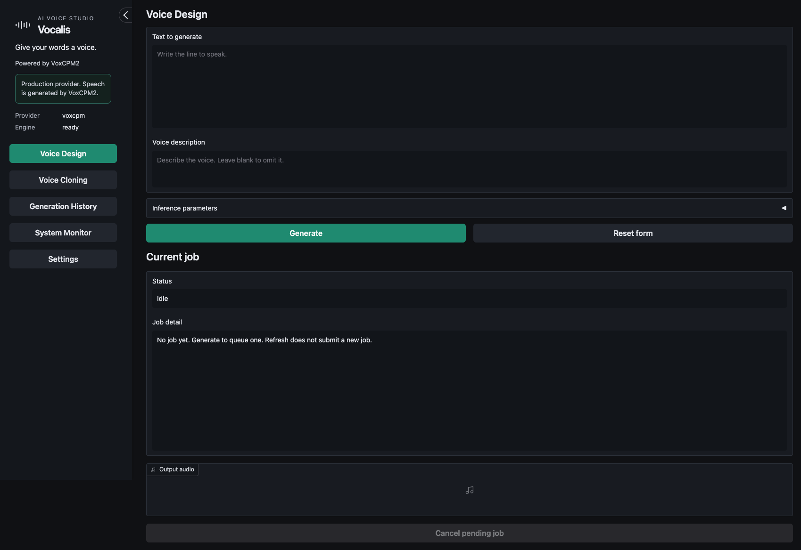
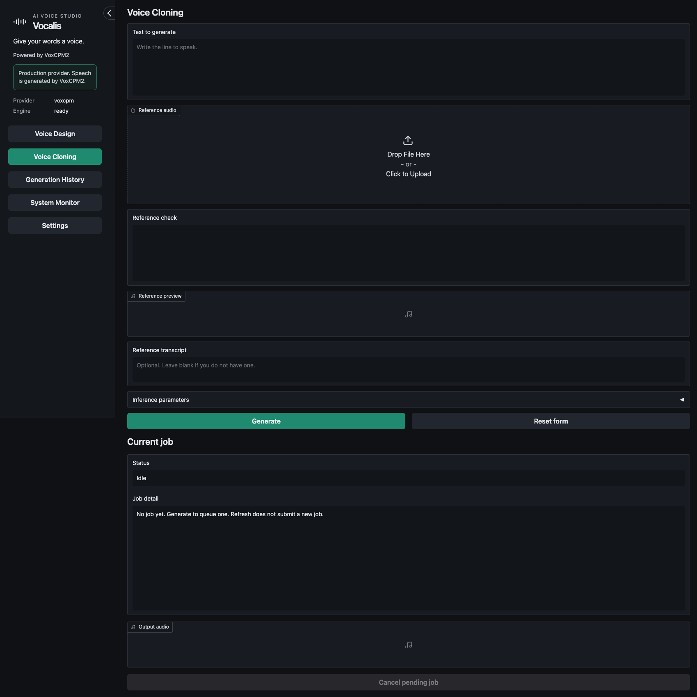
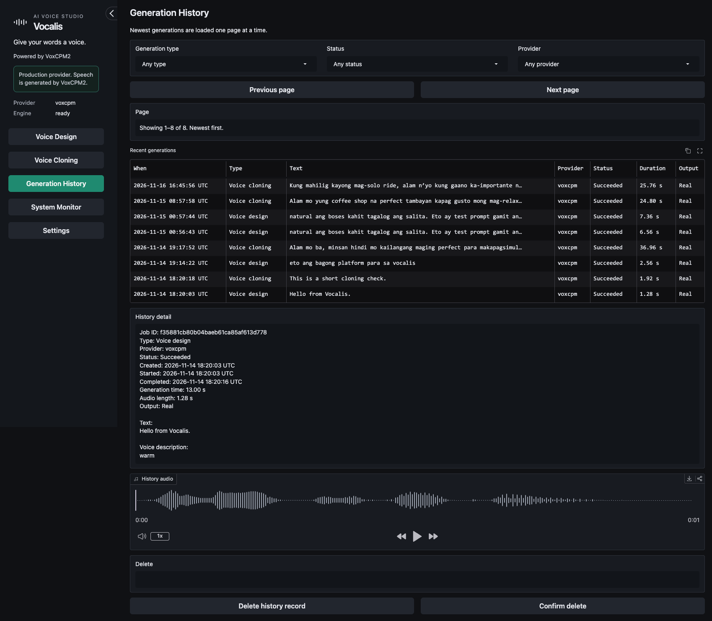

# Vocalis — AI Voice Studio

Give your words a voice.

Vocalis is a local-first AI voice studio. This repository is the application. VoxCPM2 is the optional speech engine. The default configuration uses a mock engine, so the studio, queue, and history run without downloading model weights.

Install it with [INSTALL.md](INSTALL.md).

## Screenshots

These shots are the local studio with the VoxCPM2 provider. A default mock install uses the same pages and marks its audio as simulated.







## Current status

- Default model provider: `mock`
- Voice Design, Voice Cloning, Generation History, System Monitor, and Settings are in the studio
- The mock engine simulates those two workflows and labels every file as simulated audio
- `MODEL_PROVIDER=voxcpm` uses a local VoxCPM2 install. `requirements.txt` does not install that package or PyTorch.

## Prerequisites

Python 3.11 or 3.12, Git, and a virtual environment. Platform commands and the optional real-engine setup are in [INSTALL.md](INSTALL.md).

## Configuration

Settings load from the process environment, with `.env` supplying defaults for anything the environment does not set. Relative paths resolve from the repository root and must stay inside it. Absolute paths are allowed so production can use its own directories.

Development defaults:

```text
APP_ENV=development
MODEL_PROVIDER=mock
APP_HOST=127.0.0.1
APP_PORT=7860
GRADIO_SHARE=false
```

On startup the application creates:

```text
data/
output/design/
output/clone/
uploads/references/
logs/
```

`logs/vocalis.log` is a rotating log. Copy `.env.example` to `.env` for local changes. `.env` is gitignored.

`VOCALIS_DATABASE_PATH` is the SQLite file. The default is `./data/history.db`, resolved from the project root like the other relative paths. An absolute path is allowed when the database lives outside the repository. Settings load creates the parent directory. The file itself is created when migrations run at startup. The database is not placed in the `vocalis/` source package. Audio files stay on disk; the database stores their paths.

`MAX_CONCURRENT_GENERATIONS` stays at 1. `MAX_QUEUE_SIZE` is how many jobs may wait behind the one that is running (default 3). A submission past that limit is rejected. `MAX_UPLOAD_BYTES` is the largest reference file Voice Cloning will read (default 20 MiB).

`python app.py --check` validates configuration, creates those directories, applies database migrations, initializes the selected engine, and exits. A configuration problem prints `Configuration error:` and a non-zero status. A migration problem prints `Database error:`. The process does not print a traceback for those failures.

Public Gradio sharing is rejected. Development mode also rejects a non-loopback `APP_HOST`. Production mode requires `MODEL_PROVIDER=voxcpm` and an existing `VOXCPM_MODEL_PATH` directory. Selecting `voxcpm` before that package and model directory are installed stops startup with `Engine error:`. Example environment and systemd files live in `deploy/`.

## Mock mode

`MODEL_PROVIDER=mock` is the local default. Importing and starting Vocalis does not import `voxcpm`, `torch`, or `torchaudio`. A normal start initializes the mock engine, starts one generation worker, and keeps both for the process. `--check` starts them and shuts them down. The worker is the only caller of generation. It runs one job at a time. A job that is still waiting can be cancelled. A job that has started runs to completion; this build does not cancel an active generation.

The mock engine writes a 16 kHz mono WAV tone under `output/design/` or `output/clone/`. The file name starts with `mock-`, the file contains a simulated-audio comment, and the result says the tone is not VoxCPM2 speech. A cloning request copies the validated reference into `uploads/references` with a new `reference-` name and leaves the original file unchanged. History stores the copy. The studio says the tone is simulated on the Voice Design page, the Voice Cloning page, and the finished job. Local files under `data/` and `output/` are runtime artifacts. They are gitignored.

Reference files are checked before a cloning job is queued. WAV, FLAC, and MP3 are recognized from their contents. A matching extension is required, and a renamed or truncated file is rejected. WAV duration comes from the frame count. FLAC duration comes from the STREAMINFO sample count when that count is present. MP3 duration comes from MPEG frame headers. Compressed samples are not decoded, and a duration is not invented when the file structure does not contain one. No extra audio package is installed for these checks.

## Generation history

Startup applies numbered SQL migrations once and records them in `schema_migrations`. Each connection enables WAL mode and foreign keys, then closes when the operation finishes. A connection is not held while a generation is running.

The queue writes a row when a job is accepted, when it starts, and when it succeeds, fails, or is cancelled. The insert happens before the job can start. The running update happens before inference starts. A successful result is stored before callers see the job as succeeded. If the initial insert fails, the job is not queued. If saving a result fails, the job is recorded as failed and the caller does not see a success. Completed, failed, and cancelled rows remain after a restart. A row still marked `queued` or `running` from an earlier process is marked failed with `Generation interrupted because Vocalis restarted before completion.` Those jobs are not started again.

The worker keeps the newest 100 jobs in memory. A job that is queued or running stays even when that limit is already reached. Older finished jobs leave memory and remain in SQLite. The history page reads SQLite. A service stop waits up to five minutes for the generation that is already running, then exits. Waiting jobs are cancelled.

History can be listed newest first, with limit and offset, and filtered by generation type, status, or provider. The studio loads one page at a time. Deleting a history row leaves the generated file and the reference file on disk, and the page asks for confirmation before it deletes the row. Automatic file deletion is later work. Logs record job ids and statuses, and they do not record the submitted text, voice description, or transcript.

## Studio

The Gradio app is one local process. Pages call `VoiceDesignService`, `VoiceCloningService`, `AudioService`, and `HistoryService`. They do not call `ModelManager.generate()`. Generate returns as soon as the queue accepts the job. Two timers are created with the app: one refreshes the current job every 2 seconds while that job is queued or running, and one refreshes System Monitor every 5 seconds while that page is open. Opening a page or refreshing a job does not submit another generation. A pending job can be cancelled. A running job cannot.

System Monitor reads CPU and memory through `psutil`, which is included so the page can show those readings without a monitoring service. It does not read GPU devices. Settings is read-only and does not print environment secrets or filesystem paths.

## Real engine

The adapter targets the published `voxcpm` 2.0.3 package. A normal install does not install that package and does not download the model. `MODEL_PROVIDER=mock` remains the default.

`MODEL_PROVIDER=voxcpm` selects the VoxCPM2 adapter. The adapter imports `voxcpm` only when the engine initializes. It loads the directory in `VOXCPM_MODEL_PATH` once, with `load_denoiser=False`, `optimize=False`, `device="cpu"`, and `local_files_only=True`. Later requests reuse that loaded model. Voice design sends the text, with a voice description wrapped as `(description)` when one is present. Voice cloning sends `reference_wav_path`. A reference transcript is also sent as `prompt_text` with the same file as `prompt_wav_path`. The result is a float waveform saved as 16-bit WAV. The 2.0.3 package has no `seed` argument and no progress or cancellation callback. If the package is absent, selecting `voxcpm` fails at startup with `Engine error:`.

## Testing

With the virtual environment active:

```bash
python -m pytest
python app.py --check
```

The tests use temporary directories. They do not download a model. `tests/unit` covers the modules, including the in-memory job limit. `tests/integration` runs a mock generation through the queue, the history database, and the studio callback, including a rejected submission that leaves the current job in place and a cloning reference that is copied without changing the original.

## Directory structure

```text
app.py
INSTALL.md
README.md
requirements.txt
requirements-dev.txt
requirements-prod.txt
.env.example
pyproject.toml
deploy/
    vocalis.service
    vocalis.env.example
    rsync-excludes.txt
docs/
    production.md
    images/
        studio-voice-design.png
        studio-voice-cloning.png
        studio-history.png
vocalis/
    core/
        config.py
        logging.py
        exceptions.py
        types.py
    engine/
        base.py
        factory.py
        mock_engine.py
        model_manager.py
        voxcpm_engine.py
    persistence/
        database.py
        models.py
        migrations/
        repositories/
            generations.py
    services/
        audio.py
        cloning.py
        design.py
        history.py
        jobs.py
        queue.py
    utils/
        audio.py
        audio_inspect.py
    ui/
        actions.py
        foundation.py
        present.py
        runtime.py
        studio.py
        styles.css
        theme.py
tests/
    integration/
    unit/
```

Runtime directories (`data/`, `output/`, `uploads/`, `logs/`) and `.venv/` are created locally and are not part of Git.

## Troubleshooting

- `python` is not 3.11 or 3.12. Activate `.venv`. `python -c "import sys; print(sys.version)"` should show 3.11 or 3.12.
- `Address already in use`. Change `APP_PORT` in `.env`, then start again.
- `Configuration error` on startup. The message names the setting. The details are also written to `logs/vocalis.log` after logging is configured. A failure that happens while reading configuration is printed to the terminal.
- The finished job says it is simulated. `MODEL_PROVIDER=mock` writes a tone. It does not synthesize speech and it does not clone the uploaded voice.
- A generation submission says the queue is full. Wait for a queued job to start, or raise `MAX_QUEUE_SIZE`. The running generation still occupies the single worker.
- A reference upload is rejected. The message names an empty file, a size limit, an unsupported extension, or contents that are not a valid WAV, FLAC, or MP3.
- `Engine error` on startup. `MODEL_PROVIDER=voxcpm` is selected and the `voxcpm` package is not installed in this environment. Use `MODEL_PROVIDER=mock` for local development.
- `Database error` on startup. The message names the migration that failed. Generation history was not left half-applied for that migration.
